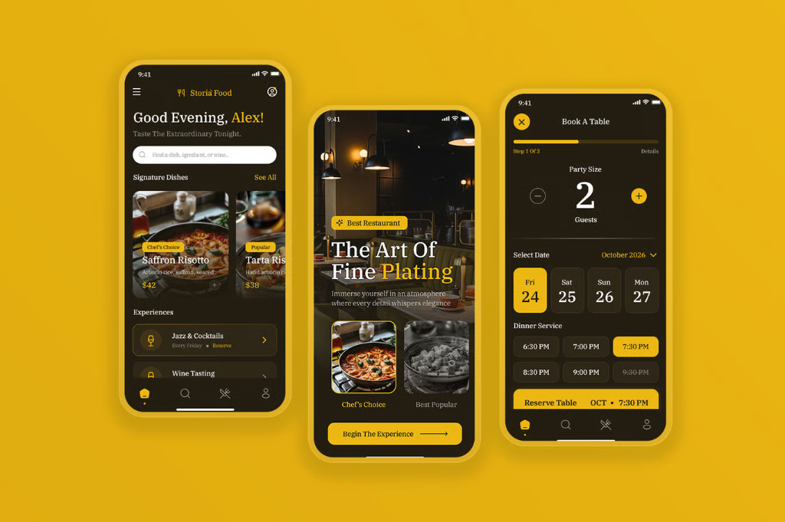
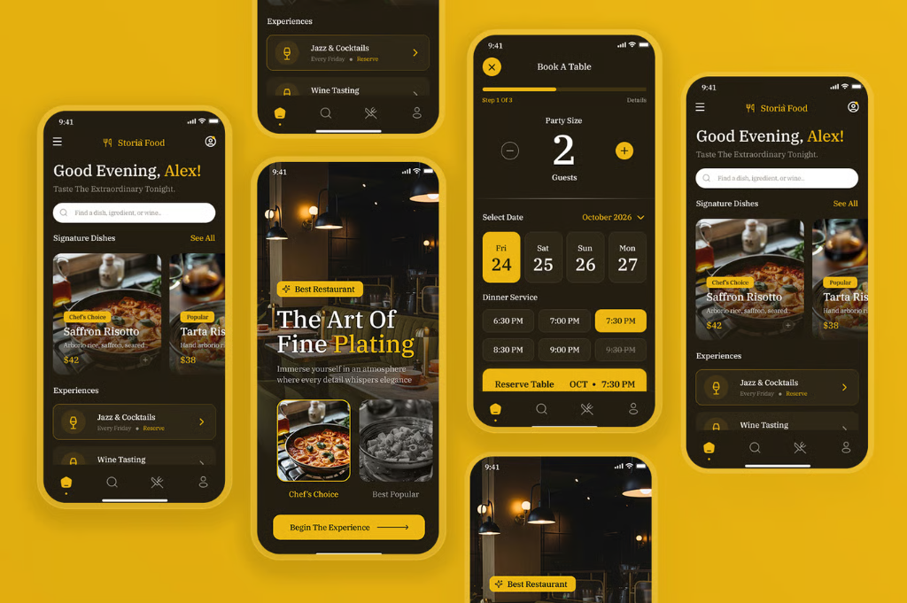
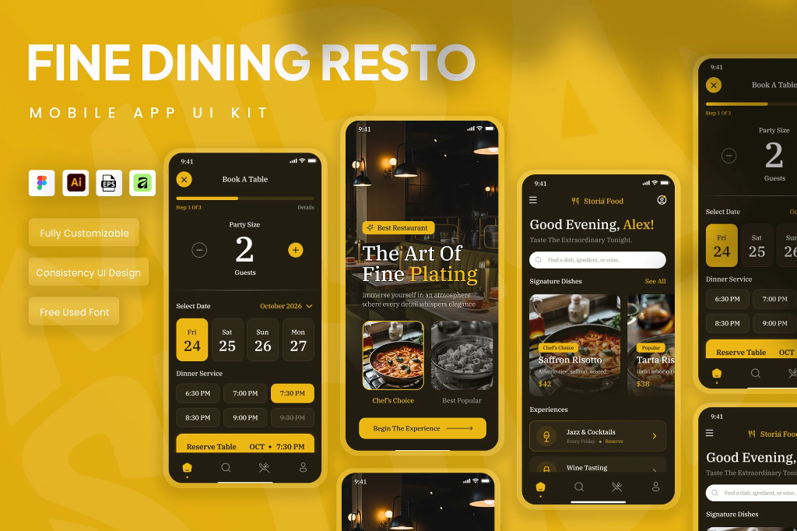

# 🍽️ Storià Food — Fine Dining & Food Delivery App (`wds-food-delivery-lenhuthuc`)

Ứng dụng đặt món trực tuyến & trải nghiệm ẩm thực cao cấp **Storià Food** được xây dựng theo kiến trúc **Monorepo** với **Next.js 16 (App Router)**, **Tailwind CSS**, **shadcn/ui**, **Zustand (Persist)**, **React Hook Form** và **Zod**.

Giao diện lấy cảm hứng từ phong cách **Fine Dining Resto** với tông màu Đen Espresso (`#12100E`) kết hợp Vàng Hoàng Gia (`#EAB308`), mang đến trải nghiệm sang trọng và mượt mà trên cả Mobile (`375px`) lẫn Desktop.

---

## 📸 Screenshots Giao Diện

| Màn hình Khám Phá & Đặt Bàn | Tổng quan UI Kit & Trải Nghiệm | Chi Tiết Thiết Kế Fine Dining |
| :---: | :---: | :---: |
|  |  |  |

---

## 🏗️ Cấu trúc Monorepo

```text
Food Delivery App - Frontend/
├── apps/
│   ├── web/                        # Frontend Next.js 16 + Tailwind CSS + shadcn/ui
│   │   ├── data/                   # Mock data nhà hàng & món ăn (chuẩn schema Buổi 4)
│   │   └── src/
│   │       ├── app/                # Next.js 16 App Router (Server/Client Components)
│   │       │   ├── api/orders/     # Mock API Route Handler xử lý đặt hàng
│   │       │   ├── checkout/       # Trang Checkout (React Hook Form + Zod)
│   │       │   ├── profile/        # Trang User Profile (Zod Schema Validation)
│   │       │   └── restaurant/[id] # Trang chi tiết nhà hàng + nested layout/loading/error/not-found
│   │       ├── components/         # UI Components (shadcn/ui, Header, Footer, CartDrawer...)
│   │       ├── data/               # Mock data (4 nhà hàng Fine Dining, 24 món ăn)
│   │       ├── lib/validations/    # Zod Schemas (Checkout Schema & User Profile Schema)
│   │       └── store/              # Zustand Cart Store (với persist LocalStorage)
│   └── api/                        # Backend API Service (chuẩn bị cho Buổi 4)
├── docs/
│   ├── PRD.md                      # Tài liệu Product Requirements Document
│   └── screenshots/                # Hình ảnh giao diện dự án
├── scripts/
│   └── check-ac.mjs                # Bộ kiểm tra tự động Chuẩn đầu ra (AC) cho 3 buổi
├── AGENTS.md                       # Hướng dẫn dành cho OpenCode & AI Agents
├── README-CHECK.md                 # Hướng dẫn sử dụng bộ tự kiểm tra AC
├── docker-compose.yml              # Cấu hình Docker (PostgreSQL 16 & Redis 7)
└── pnpm-workspace.yaml             # Cấu hình pnpm workspace
```

---

## ✨ Tính năng hoàn thiện theo từng buổi

### Buổi 1 — Nền tảng dự án & Khung giao diện
- **A. Môi trường, Git Flow & Repo**:
  - Monorepo với `apps/web` và `apps/api`.
  - Đầy đủ `README.md`, `AGENTS.md`, `.gitignore`, `/docs/PRD.md`, `docker-compose.yml`.
  - Quản lý nhánh theo `feat/...` và lịch sử commit chuẩn **Conventional Commits**.
- **B. Khung giao diện Tailwind CSS + shadcn/ui**:
  - Khởi tạo **Next.js 16** trong `apps/web` bằng `pnpm`.
  - Tích hợp **Tailwind CSS** và các component **shadcn/ui** (`Button`, `Card`, `Badge`, `Sheet`, `Input`, `Textarea`, `Label`, `Separator`, `Skeleton`, `Sonner`).
  - Layout gồm `Header` và `Footer` chuẩn phong cách *Storià Food*, co giãn mượt mà từ Mobile (`375px`) đến Desktop, không bị tràn ngang.

### Buổi 2 — App Router, Server/Client Components & Giỏ hàng Zustand
- **Mock Data (`/data`)**: 4 nhà hàng cao cấp (*Storià Fine Dining*, *L'Atelier de Saigon*, *Kuroshio Omakase*, *Trattoria Bella Notte*), mỗi nhà hàng có 6 món ăn (tổng 24 món) với đầy đủ các trường chuẩn schema (`id`, `name`, `price`, `imageUrl`, `restaurantId`, `description`, `category`, `badge`...).
- **Server Components & Dynamic Routes**:
  - Trang chủ (`/`) hiển thị danh sách nhà hàng, món ăn đặc trưng (*Signature Dishes*) và trải nghiệm (*Jazz & Cocktails*, *Wine Tasting*) bằng Server Component.
  - Trang `/restaurant/[id]` hiển thị thực đơn chi tiết của từng nhà hàng kèm nested `layout.tsx`, `loading.tsx`, `error.tsx` và `not-found.tsx` khi truy cập `id` không tồn tại.
  - Chỉ sử dụng `"use client"` ở những component có tương tác (`AddToCartButton`, `CartDrawer`, `FloatingCartBadge`, `Header`).
- **Zustand Cart Store + Persist**:
  - Đầy đủ actions: `addItem`, `removeItem`, `increaseQuantity`, `decreaseQuantity`, `updateQuantity`, `clearCart` cùng selectors tính tổng số lượng (`selectTotalItems`) và tổng tiền (`selectTotalPrice`).
  - Bật `persist` lưu vào `localStorage` — reload trang vẫn giữ nguyên giỏ hàng.
  - Có **Cart Drawer** xem trước đơn hàng, **Floating Cart Badge** góc dưới màn hình và thông báo **Toast (Sonner)** mỗi khi thêm hoặc bớt món.

### Buổi 3 — Form Checkout với React Hook Form, Zod & Mock API
- **Trang `/checkout`**: Dẫn trực tiếp từ nút *"Tiến hành đặt hàng"* trong **Cart Drawer**.
- **Zod Schema & React Hook Form**:
  - Validate chặt chẽ **Họ và tên**, **Số điện thoại Việt Nam** (ví dụ `0901234567`), **Địa chỉ giao hàng** và **Ghi chú**.
  - Hiển thị đúng 1 thông báo lỗi tiếng Việt rõ ràng ngay bên dưới từng trường nhập sai.
  - Bổ sung Zod Schema & Form cho **User Profile** tại `src/lib/validations/profile.schema.ts` và trang `/profile`.
- **Mock API & Trạng thái Submit**:
  - Gửi đơn hàng tới Route Handler `POST /api/orders`.
  - Hiện **Spinner** và vô hiệu hóa nút bấm trong lúc đang gửi.
  - Sau khi thành công: Hiển thị màn hình xác nhận đơn hàng kèm **Mã đơn hàng giả lập** (`ORD-2026-...`) và tự động xóa sạch giỏ hàng.

---

## 🚀 Hướng dẫn cài đặt và khởi chạy

### 1. Yêu cầu hệ thống
- **Node.js**: LTS (`>= 20.x`)
- **pnpm**: `>= 9.x`
- **Git** & **Docker Desktop**

Kiểm tra nhanh môi trường:
```bash
node -v
pnpm -v
git --version
docker -v
```

### 2. Cài đặt dependencies
```bash
pnpm install
```

### 3. Khởi động dịch vụ Docker (Tùy chọn)
```bash
docker compose up -d
```

### 4. Chạy ứng dụng ở chế độ Development
```bash
pnpm dev
```
Sau đó mở trình duyệt tại địa chỉ: **[http://localhost:3000](http://localhost:3000)**

### 5. Tự kiểm tra Chuẩn đầu ra (AC Check)
Đọc file [`README-CHECK.md`](./README-CHECK.md) hoặc chạy lệnh:
```bash
pnpm check:ac
```
